<p align="center">
  
</p>

<h1 align="center">Antigravity Manager</h1>

<p align="center">
  <strong>Google account management, quota tracking and a local API gateway for Antigravity</strong>
</p>

<p align="center">
  English | <a href="README.zh-CN.md">简体中文</a>
</p>

<p align="center">
  <a href="https://github.com/Draculabo/AntigravityManager/actions/workflows/testing.yaml">
    
  </a>
  <a href="https://github.com/Draculabo/AntigravityManager/actions/workflows/lint.yaml">
    
  </a>
  <a href="https://github.com/Draculabo/AntigravityManager/releases">
    
  </a>
  <a href="https://github.com/Draculabo/AntigravityManager/releases">
    
  </a>
  <a href="https://github.com/Draculabo/AntigravityManager/blob/main/LICENSE">
    
  </a>
  <a href="https://github.com/Draculabo/AntigravityManager/stargazers">
    
  </a>
</p>

<p align="center">
  
  
  
  
</p>

---

Antigravity Manager is a desktop application for managing the Google accounts used by Antigravity clients (including Classic, Antigravity IDE and `agy` CLI). View model quota in real time, switch client accounts seamlessly, and connect AI coding tools like Claude Code, Codex and OpenCode through a high-performance local API gateway.

## Contents

- [Download and install](#download-and-install)
- [Nix / NixOS](#nix--nixos)
- [First use](#first-use)
- [Features](#features)
- [Screenshots](#screenshots)
- [Data and account risks](#data-and-account-risks)
- [Troubleshooting and feedback](#troubleshooting-and-feedback)
- [Development and documentation](#development-and-documentation)
- [Contributing](#contributing)
- [License](#license)
- [Disclaimer](#disclaimer)

---

## Download and install

Download an installer for your operating system and processor architecture from [GitHub Releases](https://github.com/Draculabo/AntigravityManager/releases/latest). Available files and release notes on that page are authoritative for each version.

| Platform | Architectures                          | Packages                                             |
| -------- | -------------------------------------- | ---------------------------------------------------- |
| Windows  | x64, ARM64                             | NSIS setup (`-nsis.exe`); MSI also available for x64 |
| macOS    | Apple Silicon (`arm64`), Intel (`x64`) | DMG installers; ZIP standalone archives              |
| Linux    | x64, ARM64                             | AppImage, DEB, RPM packages                          |

> [!NOTE]
>
> - **Architecture names**: Choose `arm64` or `aarch64` for ARM64, and `x64`, `amd64` or `x86_64` for x64 according to the asset name.
> - **Windows**: Executables ending in `-nsis.exe` identify standard NSIS installers. Keep the same installer family when updating an existing installation.
> - **macOS**: Move the application to `/Applications` before opening it.
> - **Linux**: Select the package appropriate for your distribution; running AppImage requires a supported runtime environment.
> - Desktop packages include their application runtime. Node.js and pnpm are required only for [source development](#development-and-documentation).

### Other installation options

- **Arch Linux**: The [community AUR package](https://aur.archlinux.org/packages/antigravity-manager-bin) can be installed with `yay -S antigravity-manager-bin`. Its version and availability are maintained separately from GitHub Releases.

### Nix / NixOS

With Nix flakes enabled, run the application directly on Linux x64 or ARM64:

```bash
nix run github:Draculabo/AntigravityManager
```

For a persistent NixOS installation, add the flake input:

```nix
inputs.antigravity-manager.url = "github:Draculabo/AntigravityManager";
```

Then apply its overlay in a NixOS module with `inputs` available:

```nix
{ inputs, pkgs, ... }: {
  nixpkgs.overlays = [ inputs.antigravity-manager.overlays.default ];
  nixpkgs.config.allowUnfree = true;
  environment.systemPackages = [ pkgs.antigravity-manager ];
}
```

For Home Manager, use `home.packages` and configure the overlay and unfree policy on its owning nixpkgs instance. The flake pins a release and may lag behind the latest assets. See [Nix integration](docs/development.md#nix-integration) for details and development-shell configuration.

---

## First use

### Add accounts and switch clients

1. Open Manager and add a Google account through browser authorization. To discover existing local accounts, use **Import from this computer**, review the preview, and confirm the accounts to import.
2. Refresh quota and inspect the available models, remaining quota and reset times. Model access depends on the account and upstream service. Gemini and Claude entries describe models available through those Google accounts.
3. Select the intended Antigravity client target: **Antigravity (Classic)**, **Antigravity IDE** or **agy CLI**. Save work in a desktop client before switching; switching can close and relaunch it.
4. Switch to the selected account, then verify the signed-in identity in the official client. Complete any official first-use setup or terms confirmation shown there.
5. Enable automatic switching if desired. Client switching and account selection for proxy requests have separate policies.

See the [account and quota guide](docs/modules/cloud-account/overview.md) for automatic switching, quota windows and optional weekly warmup.

### Connect a coding tool or API client

1. Add a usable Google account and refresh its quota.
2. Open **API Proxy**, review the [account risks](#data-and-account-risks), and confirm the warning when starting the service for the first time.
3. Use the tool configuration cards for **Claude Code**, **Codex** or **OpenCode**. Select an available model and review settings before applying them. For another API client, use the gateway address and API key shown in Manager.
4. Reopen the configured tool and send a small request. Confirm the request and result in **Traffic Monitor**; saved configuration alone does not establish that the connection works.

Tool configuration changes local client settings. Read the [configuration and recovery guide](docs/modules/proxy-gateway/agent-tools.md) for backup, removal and restoration behavior.

---

## Features

| Area                              | What Manager provides                                                                                                    |
| --------------------------------- | ------------------------------------------------------------------------------------------------------------------------ |
| **Google account pool**           | Browser authorization, local account discovery, account status, batch actions and JSON import/export                     |
| **Quota views**                   | Five-hour, weekly or combined views; model visibility controls, sorting and manual or periodic refresh                   |
| **Client account switching**      | Manual switching for Classic, IDE and agy CLI, with optional automatic switching based on account quota and rate limits  |
| **Local API gateway**             | OpenAI Chat Completions and Responses, Anthropic Messages and native Gemini interfaces, with model routing and streaming |
| **Coding tool setup**             | Configure Claude Code, Codex and OpenCode connections, with tool-specific backup and recovery                            |
| **Backups and identity profiles** | Local account snapshots and restoration, plus optional client identity-profile management                                |
| **Diagnostics**                   | Traffic inspection, error details, diagnostic references for supported operations and a user-reviewed GitHub report flow |
| **Desktop controls**              | System tray, quota notifications, appearance settings, compact account layouts and English, Chinese and Russian UI       |

> [!NOTE]
>
> - Protocol compatibility depends on the requested feature, model and upstream behavior. See the [gateway reference](docs/modules/proxy-gateway/README.md) for supported paths and limitations.
> - Weekly warmup is optional and off by default. It sends real model requests and can consume quota or AI credits. See its [behavior and limits](docs/modules/cloud-account/overview.md#weekly-warmup) before enabling it.

---

## Screenshots

<p align="center">
  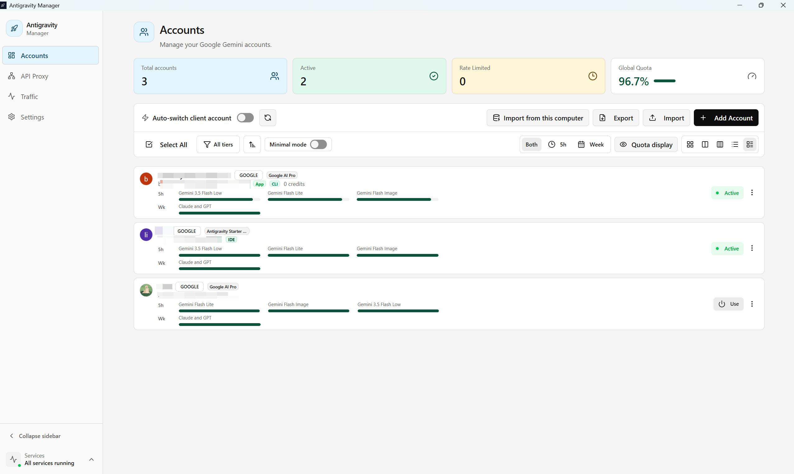
</p>

Expand each section to view the screens by feature. Long pages are captured in sections for readability. Record totals include local app activity from the demo instance; the model request list is empty.

<details>
<summary><strong>API proxy: service, tools, models, records and examples</strong></summary>

<br />

**Service status and basic configuration**

<p align="center">
  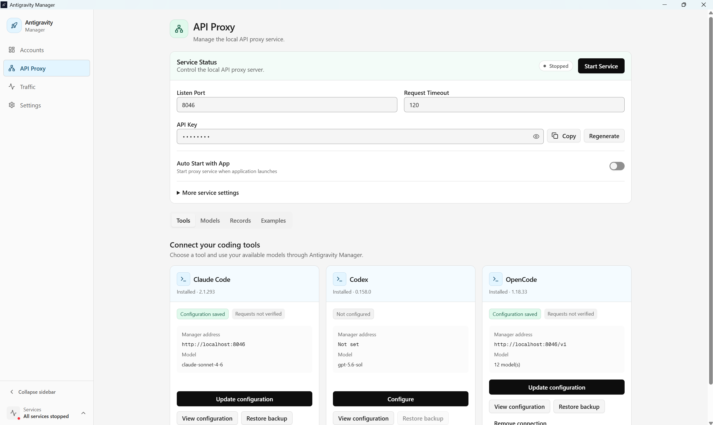
</p>

**Complete Claude Code, Codex and OpenCode controls**

<p align="center">
  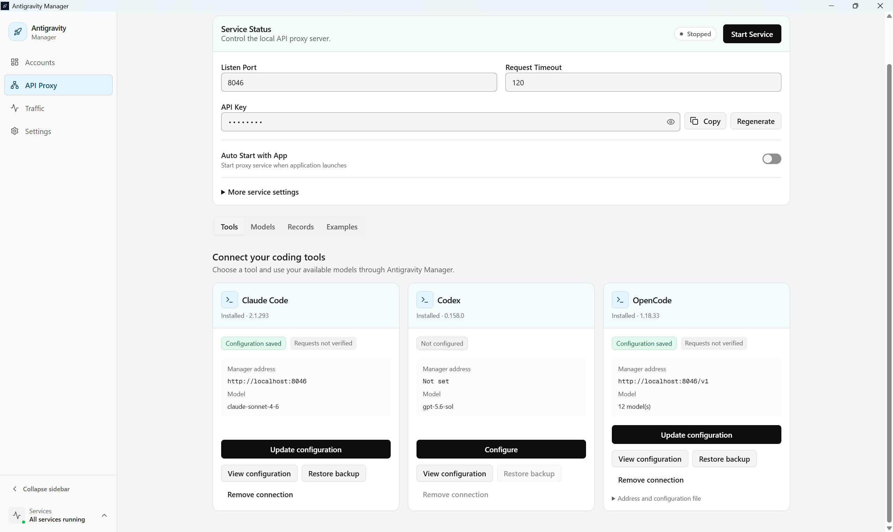
</p>

**Model mapping**

<p align="center">
  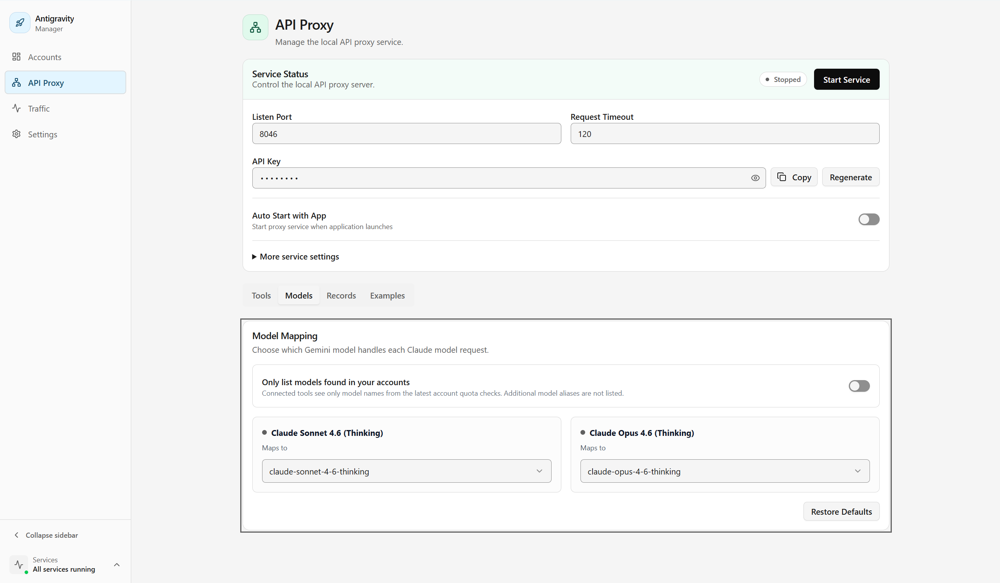
</p>

**Request and reasoning history retention**

<p align="center">
  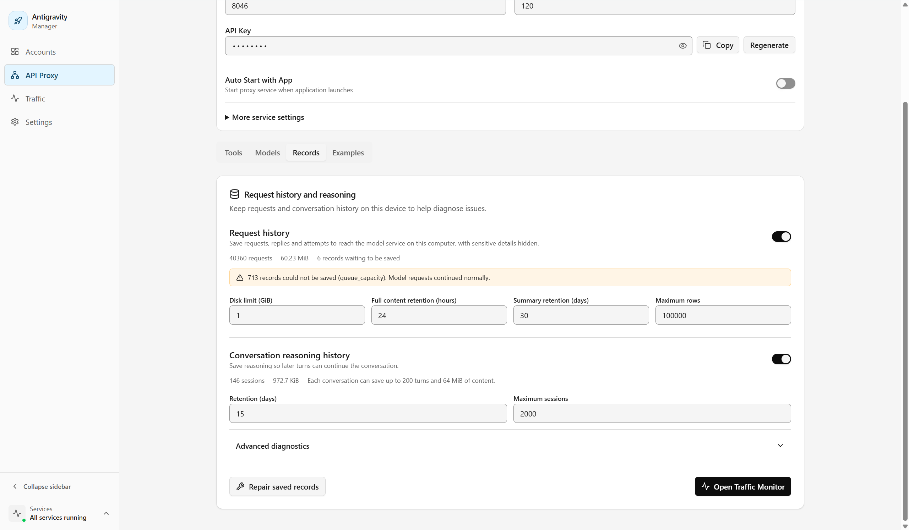
</p>

**OpenAI protocol examples in cURL and Python**

<p align="center">
  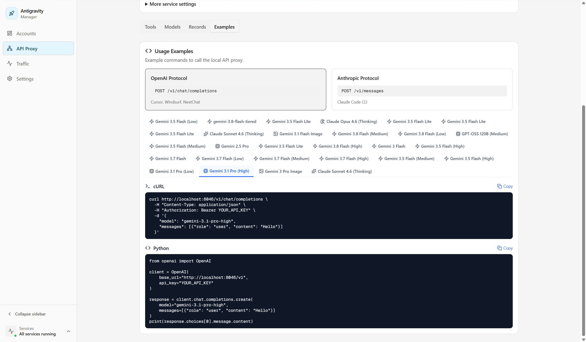
</p>

**Anthropic protocol examples in cURL and Python**

<p align="center">
  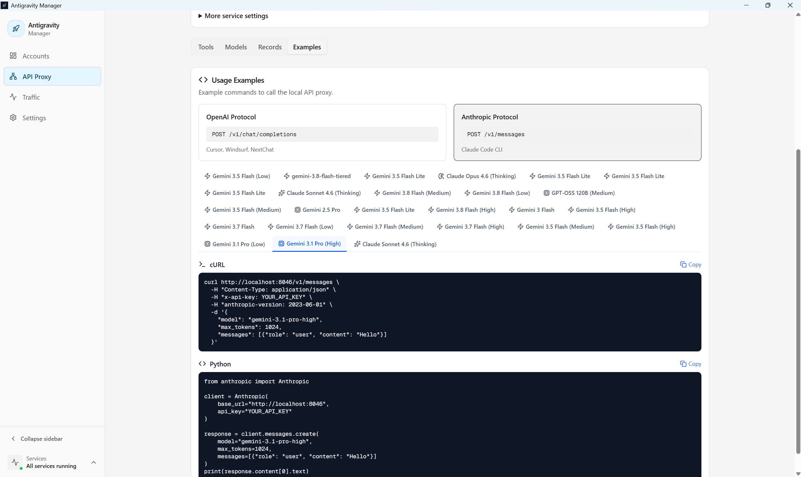
</p>

</details>

<details>
<summary><strong>Traffic monitor</strong></summary>

<br />

**Model requests and filters (no model requests)**

<p align="center">
  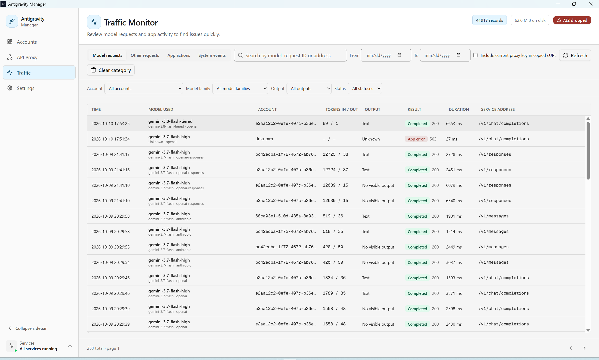
</p>

</details>

<details>
<summary><strong>Settings: general, models and proxy</strong></summary>

<br />

**Appearance, account refresh and startup**

<p align="center">
  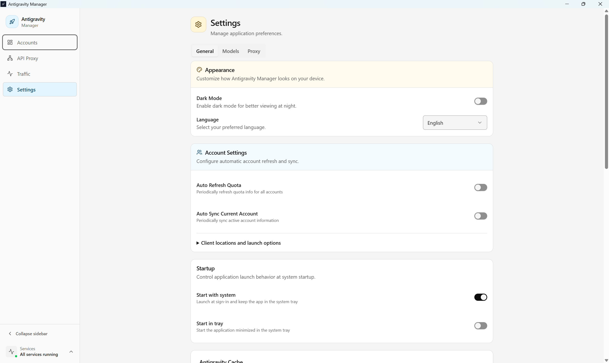
</p>

**Client cache and application information**

<p align="center">
  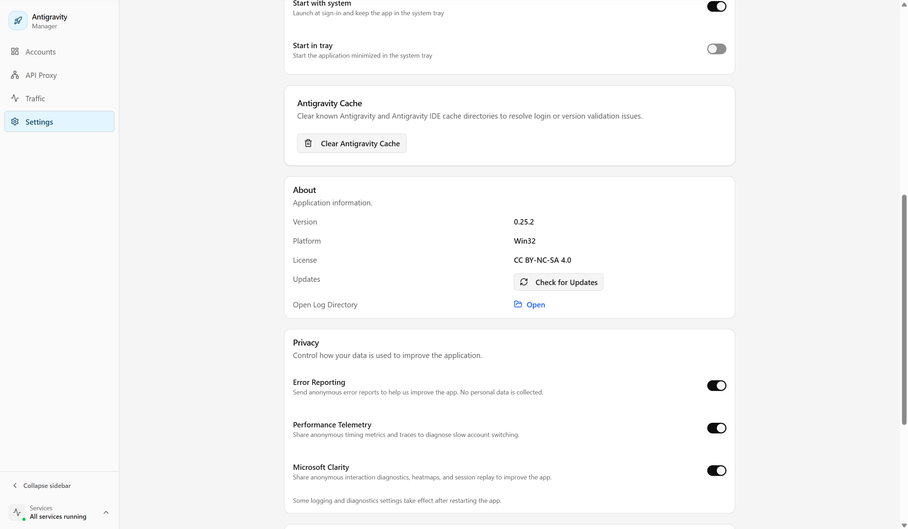
</p>

**Privacy options and notification thresholds**

<p align="center">
  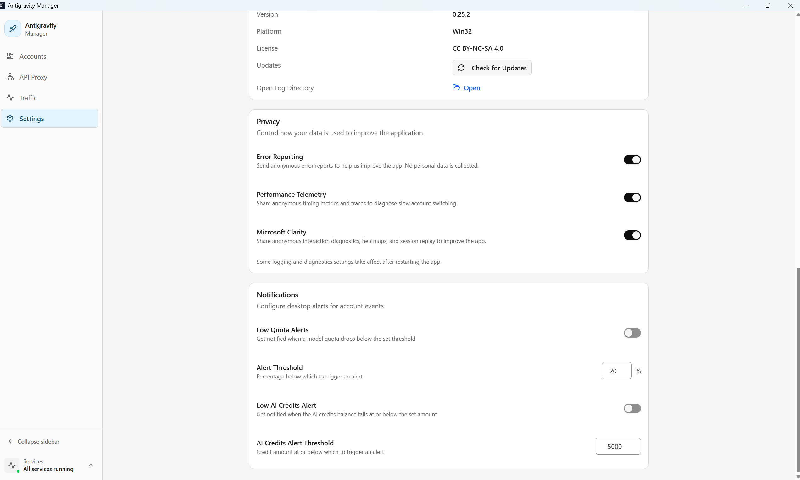
</p>

**Model visibility**

<p align="center">
  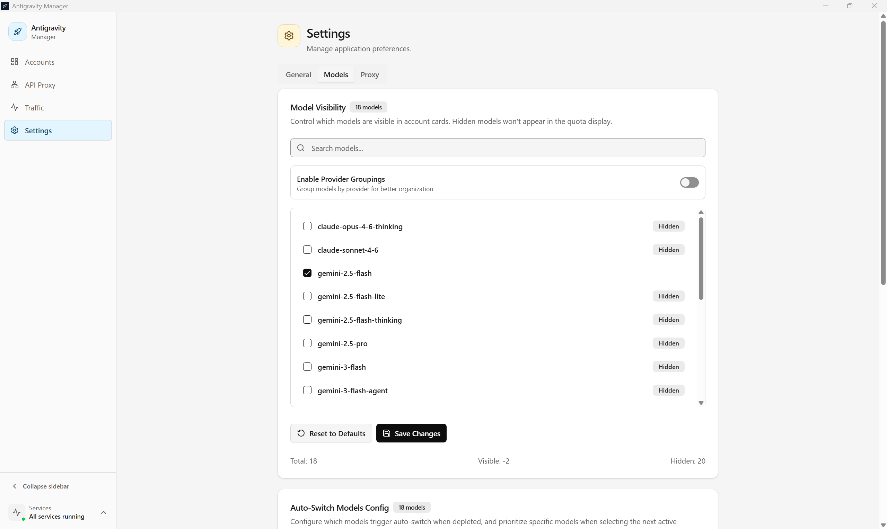
</p>

**Auto-switch models and weekly quota warmup**

<p align="center">
  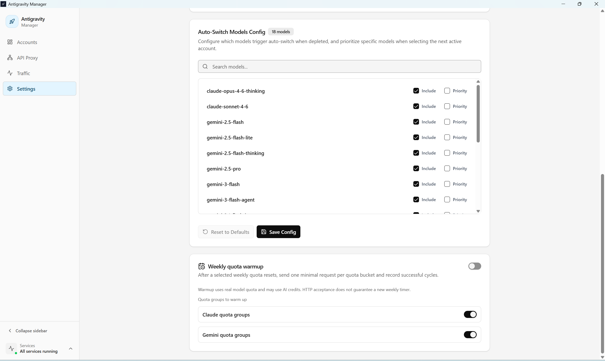
</p>

**Local service and upstream proxy settings**

<p align="center">
  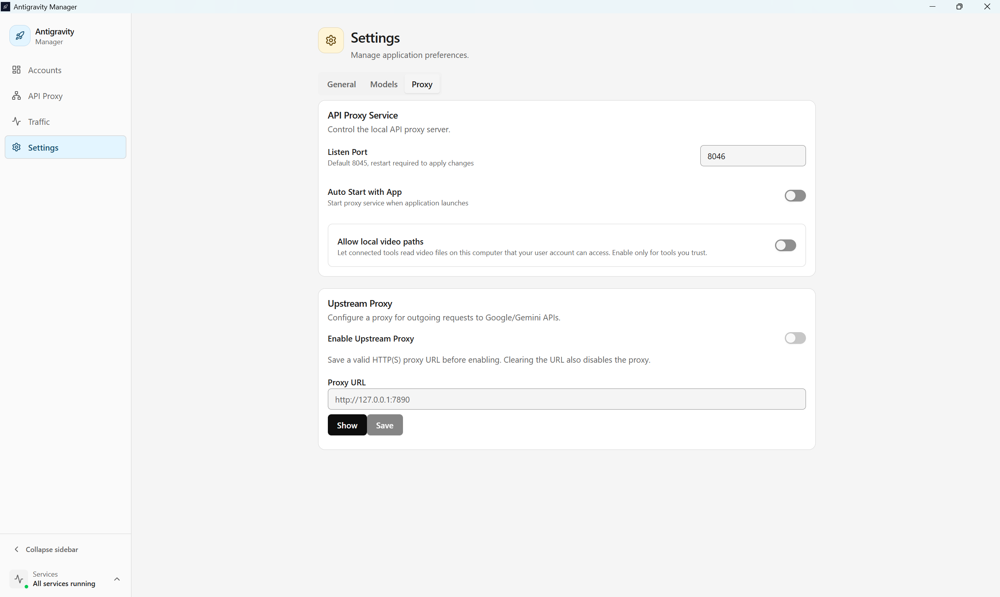
</p>

</details>

<details>
<summary><strong>CLI command output</strong></summary>

<br />

**Command line help and stopped-service output**

<p align="center">
  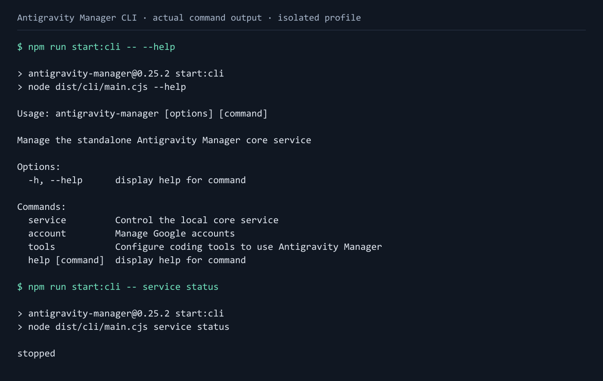
</p>

</details>

---

## Data and account risks

> [!WARNING]
> Cloud-account OAuth tokens are stored as **plaintext JSON in the local SQLite database**. Anyone who can read that database can read the tokens. Full account exports and backups can also contain tokens and proxy credentials. Protect the profile directory and backups, and never attach them to public issues.

Other credential stores retain their own OS keyring or encrypted-storage policies. See [security and data boundaries](docs/security.md) for the full policy, migration behavior and diagnostic privacy.

> [!WARNING]
> Reverse-proxy use can violate provider terms and lead to account restrictions or suspension. Use only accounts you can afford to lose. Manager does not guarantee account safety, model availability or uninterrupted access.

The first desktop proxy start requires acknowledgment of the risk warning. Cancelling or closing that dialog leaves the service stopped. Protect the proxy API key and review network access before allowing other devices to connect.

---

## Troubleshooting and feedback

### The installed application does not start

Confirm the downloaded package matches the OS and CPU architecture, and record the application version and exact error. For source builds, follow the [development prerequisites](docs/development.md#prerequisites). For packaged applications, include installer type and whether the failure occurs during installation or launch when reporting it.

### Login or account switching fails

Open **Details** on the error notification when available. Keep the diagnostic reference and note the target client, platform and action that failed. Check network/proxy settings and any official-client setup still awaiting confirmation. Back up the profile before resetting application data.

On macOS, distinguish an application launch warning from an OAuth save failure or a client-switch failure. These involve different steps; capture the exact error before changing credentials or application signing.

### The coding tool cannot reach a model

Check that the gateway is running, the account can access the selected model, and the tool uses the displayed endpoint and key. Environment variables, command-line options or direct-login plugins can override saved settings. Inspect **Traffic Monitor** and the [tool configuration guide](docs/modules/proxy-gateway/agent-tools.md).

### Report a problem

Use **Report to GitHub** from an error notification when available. Manager copies environment information and redacted error details, then opens the issue template. Review the copied report before pasting and submitting it. Otherwise, open [GitHub Issues](https://github.com/Draculabo/AntigravityManager/issues) and include reproduction steps, version, OS, architecture and any diagnostic reference.

Exclude tokens, API keys, account databases, private prompts and unreviewed logs from public reports.

---

## Development and documentation

Source development requires Node.js `24.22.0`, pnpm `10.34.6` and the native build prerequisites for your platform. Use the checked-in pnpm lockfile:

```bash
git clone https://github.com/Draculabo/AntigravityManager.git
cd AntigravityManager
pnpm install --frozen-lockfile
pnpm start
```

See [Development](docs/development.md) for builds, local Git checks and platform requirements, and [Architecture](docs/architecture.md) for desktop and standalone CLI/core operation. Use [Testing](docs/testing.md) to choose validation, and the [script guide](scripts/README.md) to locate acceptance tools.

| Reference                                                    | Contents                                                        |
| ------------------------------------------------------------ | --------------------------------------------------------------- |
| [Documentation index](docs/README.md)                        | Cross-cutting guides and documentation ownership                |
| [Feature module index](docs/modules/README.md)               | Guides grouped by the responsible feature                       |
| [Architecture](docs/architecture.md)                         | Electron, renderer, standalone core and module boundaries       |
| [Accounts and quota](docs/modules/cloud-account/overview.md) | Account management, quota views, automatic switching and warmup |
| [Proxy gateway](docs/modules/proxy-gateway/README.md)        | Protocol compatibility, coding tools and traffic debugging      |
| [Security](docs/security.md)                                 | Credentials, backups, diagnostics and trust boundaries          |

---

## Contributing

Read [CONTRIBUTING.md](CONTRIBUTING.md) before opening a change. Contributions follow the [Contributor Covenant](CODE_OF_CONDUCT.md).

---

## License

[CC BY-NC-SA 4.0](LICENSE). Commercial use is prohibited.

---

## Disclaimer

> [!WARNING]
> **For Educational Purposes Only**
>
> This project is intended solely for educational and research purposes. It is provided "as-is" without any warranty. **Commercial use is strictly prohibited.**
>
> By using this software, you agree that you will not use it for any commercial purposes, and you are solely responsible for ensuring your use complies with all applicable laws and regulations. The authors and contributors are not responsible for any misuse or damages arising from the use of this software.

---

<p align="center">
  If this project helps you, please give it a ⭐ <strong>Star</strong>!
</p>
