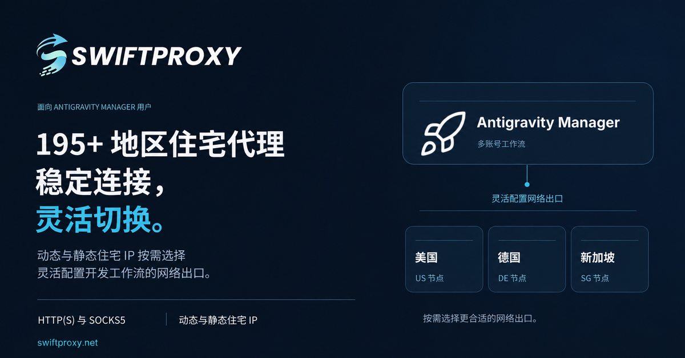

<p align="center">
  
</p>

<h1 align="center">Antigravity Manager</h1>

<p align="center">
  <strong>Antigravity 的 Google 账号管理、额度追踪与本地 API 网关</strong>
</p>

<p align="center">
  <a href="README.md">English</a> | 简体中文
</p>

<p align="center">
  <a href="https://github.com/Draculabo/AntigravityManager/actions/workflows/testing.yaml">
    
  </a>
  <a href="https://github.com/Draculabo/AntigravityManager/actions/workflows/lint.yaml">
    
  </a>
  <a href="https://github.com/Draculabo/AntigravityManager/releases">
    
  </a>
  <a href="https://github.com/Draculabo/AntigravityManager/releases">
    
  </a>
  <a href="https://github.com/Draculabo/AntigravityManager/blob/main/LICENSE">
    
  </a>
  <a href="https://github.com/Draculabo/AntigravityManager/stargazers">
    
  </a>
</p>

<p align="center">
  
  
  
  
</p>

---

Antigravity Manager 是一款桌面应用，专用于管理 Antigravity 客户端（包括 Classic、Antigravity IDE 及 `agy` CLI）使用的 Google 账号。它提供模型额度实时监控、客户端账号平滑切换，并通过内置的高性能本地 API 网关将模型能力桥接至 Claude Code、Codex、OpenCode 等 AI 编程工具。

## 目录

- [赞助商](#赞助商)
- [下载与安装](#下载与安装)
- [Nix / NixOS](#nix--nixos)
- [首次使用](#首次使用)
- [主要功能](#主要功能)
- [界面截图](#界面截图)
- [数据与账号风险](#数据与账号风险)
- [排错与问题反馈](#排错与问题反馈)
- [开发与文档](#开发与文档)
- [贡献指南](#贡献指南)
- [许可证](#许可证)
- [免责声明](#免责声明)

---

## 赞助商

|                                                                    赞助商                                                                    | 描述                                                                                                                                                                                                                                                                                                  |
| :------------------------------------------------------------------------------------------------------------------------------------------: | :---------------------------------------------------------------------------------------------------------------------------------------------------------------------------------------------------------------------------------------------------------------------------------------------------- |
| <a href="https://www.swiftproxy.net/?ref=Draculabo"></a> | **[Swiftproxy](https://www.swiftproxy.net/?ref=Draculabo)** 提供高质量动态和静态住宅代理，拥有 9000 万+住宅 IP，覆盖全球 220+ 个地区，支持 HTTP(S)、SOCKS5、IP 轮换及粘性会话，为 AI 开发、自动化工作流和 API 访问提供可靠的代理支持。动态住宅代理低至 $0.7/GB，使用优惠码 **PROXY90** 再享九折优惠。 |

---

## 下载与安装

请前往 [GitHub Releases](https://github.com/Draculabo/AntigravityManager/releases/latest) 下载适合您操作系统与处理器架构的安装包。各版本的可用文件与变更说明以发布页为准。

| 平台    | 架构支持                                 | 安装包格式                                          |
| ------- | ---------------------------------------- | --------------------------------------------------- |
| Windows | x64、ARM64                               | NSIS 安装包（`-nsis.exe`）；x64 额外提供 MSI 安装包 |
| macOS   | Apple Silicon（`arm64`）、Intel（`x64`） | DMG 安装镜像；另提供免安装 ZIP 压缩包               |
| Linux   | x64、ARM64                               | AppImage、DEB、RPM 安装包                           |

> [!NOTE]
>
> - **架构标识**：文件名包含 `arm64` 或 `aarch64` 表示 ARM64，`x64`、`amd64` 或 `x86_64` 表示 x64。
> - **Windows**：以 `-nsis.exe` 结尾的是标准 NSIS 安装程序。升级已有版本时，请沿用原来的安装包类型。
> - **macOS**：打开前请先将应用拖移到 `/Applications` 目录中。
> - **Linux**：请选择适合发行版的包格式；运行 AppImage 需具备相应的系统运行时环境。
> - 桌面安装包已内置应用运行时。Node.js 和 pnpm 仅用于[源码开发](#开发与文档)。

### 其他安装方式

- **Arch Linux**：可通过 `yay -S antigravity-manager-bin` 安装[社区维护的 AUR 包](https://aur.archlinux.org/packages/antigravity-manager-bin)（版本与可用性独立于 GitHub Releases）。

### Nix / NixOS

启用 Nix flakes 后，可在 Linux x64 或 ARM64 上直接运行：

```bash
nix run github:Draculabo/AntigravityManager
```

若需加入 NixOS 系统配置，在 flake 中添加输入：

```nix
inputs.antigravity-manager.url = "github:Draculabo/AntigravityManager";
```

随后在具备 `inputs` 的 NixOS 模块中应用 overlay：

```nix
{ inputs, pkgs, ... }: {
  nixpkgs.overlays = [ inputs.antigravity-manager.overlays.default ];
  nixpkgs.config.allowUnfree = true;
  environment.systemPackages = [ pkgs.antigravity-manager ];
}
```

Home Manager 用户请使用 `home.packages`，并在对应的 nixpkgs 实例上配置 overlay 与 unfree 策略。更多说明与开发 Shell 配置见 [Nix 集成指南](docs/development.md#nix-integration)。

---

## 首次使用

### 添加账号并切换客户端

1. 打开 Manager，通过系统默认浏览器完成授权以添加 Google 账号。若本机已有账号会话，可使用**从本机导入**，查看预览无误后确认导入。
2. 刷新额度，查看各账号的可用模型、剩余额度与重置时间。模型权限取决于账号与上游服务，支持显示 Gemini、Claude 等系列模型。
3. 在顶部工具栏选择目标客户端：**Antigravity (Classic)**、**Antigravity IDE** 或 **agy CLI**。切换桌面客户端时可能需要重启该客户端，请在切换前保存其中的未存工作。
4. 点击切换到选定账号，随后在官方客户端中核验实际登录身份；若首次启动出现条款确认，请在官方客户端内确认完成。
5. 按需在工具栏启用**自动切换**。客户端切换与代理网关的账号调度采用独立的策略。

自动切换、额度窗口和可选的每周预热行为见[账号与额度指南](docs/modules/cloud-account/overview.md)。

### 接入编程工具或 API 客户端

1. 添加可用的 Google 账号并刷新确认额度正常。
2. 打开 **API 反代** 页面，阅读[数据与账号风险](#数据与账号风险)，并在首次启动服务时确认风险告知弹窗。
3. 点击 **Claude Code**、**Codex** 或 **OpenCode** 配置卡片，选择对应模型并检查设置后一键应用配置。若使用其他 API 客户端，直接使用 Manager 显示的网关地址与 API Key 即可。
4. 重新打开已配置的工具并发起一次测试请求。可在 **流量监控** 中查看实时请求与结果明细（仅保存配置不代表网络链路已调通）。

工具配置会修改本地客户端设置。备份、移除连接与恢复行为见[工具配置与恢复指南](docs/modules/proxy-gateway/agent-tools.md)。

---

## 主要功能

| 功能模块           | 核心能力说明                                                                                        |
| ------------------ | --------------------------------------------------------------------------------------------------- |
| **Google 账号池**  | 浏览器授权登录、本机已有会话一键发现、账号状态监测、批量操作与 JSON 导入导出                        |
| **额度多维追踪**   | 5 小时滚动窗口、每周周期与合并视图；支持模型过滤、排序及手动或定时后台刷新                          |
| **客户端账号切换** | 支持 Classic、IDE 与 agy CLI 手动切换；支持基于额度不足（<5%）或限速的自动轮换                      |
| **本地 API 网关**  | 兼容 OpenAI (Chat / Responses)、Anthropic (Messages) 与原生 Gemini 协议；支持流式传输与思考过程保留 |
| **编程工具配置**   | 一键自动配置 Claude Code、Codex 与 OpenCode 连接，提供原子更新与一键备份还原                        |
| **备份与身份配置** | 本地账号快照备份与恢复，支持独立的客户端身份配置（Identity Profiles）隔离                           |
| **诊断与问题排查** | 实时请求流量查看、响应耗时、错误详情、诊断编号记录，以及支持自动脱敏的 GitHub 反馈                  |
| **桌面集成体验**   | 原生系统托盘、额度告警通知、紧凑布局模式，支持简体中文、英文及俄语三语界面                          |

> [!NOTE]
>
> - 协议兼容性受请求功能、模型和上游行为影响。支持的路径及限制见[网关文档](docs/modules/proxy-gateway/README.md)。
> - 每周预热默认关闭，启用后会发送真实模型请求，可能消耗额度或 AI credits。启用前请阅读其[行为与限制](docs/modules/cloud-account/overview.md#weekly-warmup)。

---

## 界面截图

<p align="center">
  
</p>

<details>
<summary><strong>API 反代：服务配置、工具集成、模型映射与示例</strong></summary>

<br />

**服务状态与基础配置**

<p align="center">
  
</p>

**Claude Code、Codex 与 OpenCode 的完整操作区**

<p align="center">
  
</p>

**模型映射**

<p align="center">
  
</p>

**请求记录与推理历史保留设置**

<p align="center">
  
</p>

**OpenAI 协议的 cURL 与 Python 示例**

<p align="center">
  
</p>

**Anthropic 协议的 cURL 与 Python 示例**

<p align="center">
  
</p>

</details>

<details>
<summary><strong>流量监控</strong></summary>

<br />

**模型请求明细与筛选过滤**

<p align="center">
  
</p>

</details>

<details>
<summary><strong>设置：常规、模型与代理</strong></summary>

<br />

**外观、账号刷新与启动设置**

<p align="center">
  
</p>

**客户端缓存与应用信息**

<p align="center">
  
</p>

**隐私选项与通知阈值**

<p align="center">
  
</p>

**模型可见性**

<p align="center">
  
</p>

**自动切换模型与每周额度预热**

<p align="center">
  
</p>

**本地服务与上游代理设置**

<p align="center">
  
</p>

</details>

<details>
<summary><strong>CLI 命令行输出</strong></summary>

<br />

**命令行帮助与服务运行状态**

<p align="center">
  
</p>

</details>

---

## 数据与账号风险

> [!WARNING]
> 云账号 OAuth token 以**明文 JSON 存储在本地 SQLite 数据库中**。能够读取数据库的人也能读取这些 token。完整账号导出和备份还可能包含 token 与代理凭据。请保护数据目录和备份，不要将它们附到公开 issue 中。

其他凭据存储沿用各自的系统钥匙串或加密存储策略。完整策略、迁移行为与诊断隐私说明见[安全与数据边界](docs/security.md)。

> [!WARNING]
> 反向代理用途可能违反服务提供方的条款，并导致账号受限或暂停。请仅使用能够承担损失的账号。Manager 不保证账号安全、模型可用性或持续访问。

首次从桌面端启动代理需要确认风险提示；取消或关闭弹窗时，服务保持停止。请保护代理 API Key，并在允许其他设备连接前检查网络访问范围。

---

## 排错与问题反馈

### 安装后的应用无法启动

确认安装包与操作系统、CPU 架构匹配，并记录应用版本和具体错误。源码运行请检查[开发前置要求](docs/development.md#prerequisites)。安装包用户反馈时，请说明安装包类型，以及错误发生在安装阶段还是启动阶段。

### 登录或账号切换失败

错误通知提供**详情**入口时，先查看其中内容，保留诊断编号，并记录目标客户端、平台和失败操作。检查网络、代理设置，以及官方客户端是否仍有待完成的首次设置。重置应用数据前请先备份数据目录。

macOS 用户应区分应用启动警告、OAuth 保存失败和客户端切换失败。这些问题发生在不同环节，修改凭据或应用签名前应先记录具体错误。

### 编程工具无法访问模型

确认网关已启动、账号有权访问所选模型，以及工具使用了页面显示的地址和 Key。环境变量、命令行选项或直登插件可能覆盖保存的配置。检查**流量监控**，并参考[工具配置指南](docs/modules/proxy-gateway/agent-tools.md)。

### 反馈问题

错误通知提供 **Report to GitHub** 操作时，可以使用它复制环境信息和脱敏后的错误详情，再打开 issue 模板。粘贴和提交前请检查报告内容。也可以直接在 [GitHub Issues](https://github.com/Draculabo/AntigravityManager/issues) 中提供复现步骤、版本、操作系统、架构和诊断编号。

公开报告中请排除 token、API Key、账号数据库、私人提示词和未经检查的日志。

---

## 开发与文档

源码开发需要 Node.js `24.22.0`、pnpm `10.34.6`，以及对应平台的原生模块构建环境。请使用仓库中的 pnpm 锁文件：

```bash
git clone https://github.com/Draculabo/AntigravityManager.git
cd AntigravityManager
pnpm install --frozen-lockfile
pnpm start
```

构建、本地 Git 检查和平台要求见[开发指南](docs/development.md)，桌面与独立 CLI/core 的运行方式见[架构指南](docs/architecture.md)。按改动选择验证方式时参考[测试指南](docs/testing.md)，验收工具入口见[脚本指南](scripts/README.md)。

| 文档                                                 | 内容说明                                 |
| ---------------------------------------------------- | ---------------------------------------- |
| [文档索引](docs/README.md)                           | 通用指南与文档职责划分                   |
| [功能模块索引](docs/modules/README.md)               | 按所属功能组织的指南索引                 |
| [架构指南](docs/architecture.md)                     | Electron、渲染进程、独立 core 与模块边界 |
| [账号与额度](docs/modules/cloud-account/overview.md) | 账号管理、额度视图、自动切换与每周预热   |
| [代理网关](docs/modules/proxy-gateway/README.md)     | 协议兼容、编程工具配置与流量排查         |
| [安全规范](docs/security.md)                         | 凭据存储、备份策略、诊断与信任边界       |

---

## 贡献指南

提交改动前请阅读[贡献指南](CONTRIBUTING.md)。项目遵循 [Contributor Covenant](CODE_OF_CONDUCT.md) 行为准则。

---

## 许可证

本项目基于 [CC BY-NC-SA 4.0](LICENSE) 许可协议开源，商业使用严格禁止。

---

## 免责声明

> [!WARNING]
> **仅供教育与研究使用**
>
> 本项目仅供教育和研究目的，按“原样”提供，不提供任何形式的明示或暗示保证。**严禁商业使用。**
>
> 使用本软件即表示您同意不会将其用于任何商业目的，并自行负责确保您的使用符合所有适用的法律法规与服务条款。作者和贡献者对因使用本软件而产生的任何滥用、账号处罚或损害不承担责任。

---

<p align="center">
  如果这个项目对你有帮助，请给一个 ⭐ <strong>Star</strong> 支持！
</p>
