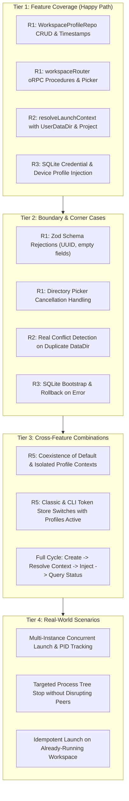

# Antigravity Manager: Multi-Instance Workspace Profile Test Infrastructure

## 1. Overview & Testing Philosophy

Antigravity Manager is transformed from a single-instance account switcher into a multi-instance workspace profile manager. This architecture enables concurrent, isolated Antigravity IDE sessions across different Google accounts and project folders.

To guarantee process isolation, persistent data integrity, and strict non-regression for existing single-client users, we establish an automated **4-Tier Verification Hierarchy**.

### Core Invariants

1. **Isolated Data Persistence (R1)**: Every workspace profile maintains dedicated persistent state in SQLite (`cloud_accounts.db`), with UUID primary keys, relational linkage to cloud accounts, and dedicated filesystem paths (`userDataDir`).
2. **Process Non-Conflict & True Concurrency (R2)**: Distinct Antigravity IDE instances running with distinct `--user-data-dir` arguments must run simultaneously without triggering `directory-conflict` or mutual process termination.
3. **Deterministic Credential Injection (R3)**: Credentials and device fingerprints are securely and transactionally injected directly into each profile's isolated SQLite database (`<userDataDir>/User/globalStorage/state.vscdb`) so the IDE launches pre-authenticated without user intervention.
4. **Targeted Process Lifecycle & Isolation (R2/R3)**: Terminating or stopping a specific workspace profile must kill only the process tree associated with that profile's canonical `--user-data-dir`, leaving peer profile sessions unaffected.
5. **Zero-Regression Invariant (R5)**: Legacy single-client workflows (Classic target without profiles, `agy` CLI token provisioning) must retain their exact operational semantics and security boundaries.

---

## 2. The 4-Tier Test Methodology



### Tier 1: Feature Coverage

- **Objective**: Validate the primary, nominal execution path for all newly introduced functions, interfaces, and IPC handlers.
- **Scope**:
  - `WorkspaceProfileRepo`: Creating profiles with generated UUIDs and directory bootstrap, listing sorted by creation date, retrieving by ID, updating mutable fields (`name`, `accountId`, `projectPath`), deleting records, and updating `lastLaunchedAt`.
  - `workspaceRouter`: Calling oRPC procedures `list`, `get`, `create`, `update`, `delete`, `launch`, `stop`, and `selectDirectory`.
  - `resolveLaunchContext`: Parameterizing with `LaunchContextOptions` (`userDataDir`, `projectPath`), appending `--user-data-dir=<profileDir>` and positional project arguments.
  - `prepareClientAccountWrite`: Directing writes to `<profile.userDataDir>/User/globalStorage/state.vscdb`, creating `ItemTable` if missing, writing protobuf `antigravityUnifiedStateSync.oauthToken`, `antigravityAuthStatus`, `antigravityOnboarding = 'true'`, and device profile machine IDs.

### Tier 2: Boundary & Corner Cases

- **Objective**: Validate system resilience when presented with malformed inputs, edge conditions, boundary limits, and unexpected environment states.
- **Scope**:
  - Empty or whitespace strings in profile name or project path.
  - Invalid UUID format rejections by Zod validators.
  - Updating or deleting non-existent profile IDs (returning null or throwing appropriate domain errors).
  - Native directory picker returning `canceled: true` (ensuring null return without throwing).
  - Launch context resolution encountering processes with invalid command lines, trailing slashes, or duplicate identical directory flags.
  - Distinguishing legitimate directory conflicts (two processes attempting to bind the same profile `--user-data-dir` with conflicting configurations) from isolated peer instances.
  - SQLite credential injection when destination directory does not pre-exist, handling locked database files, and ensuring transactional rollback if write fails midway.

### Tier 3: Cross-Feature Combinations

- **Objective**: Verify that interconnected subsystems interact correctly and maintain system invariants across multi-module workflows.
- **Scope**:
  - Full profile lifecycle integration: persisting a profile -> resolving launch context -> provisioning credentials into SQLite -> querying running status.
  - Running a profile session concurrently with a default Classic IDE session, verifying neither interferes with the other's launch context or storage paths.
  - Triggering Classic or `agy` CLI account switching while multiple workspace profiles exist, verifying global credential stores (`agyCliTokenStore`, `googleOAuthCredentialStore`, keytar/keyring) are touched exclusively for CLI/Classic without altering workspace profile SQLite databases.

### Tier 4: Real-World Scenarios

- **Objective**: Emulate end-user desktop operational flows and adversarial runtime states.
- **Scope**:
  - Multi-instance concurrency: Profile A (Google Account 1, Project A, PID 101) and Profile B (Google Account 2, Project B, PID 202) running concurrently.
  - Targeted termination: Triggering `stop` on Profile A invokes process termination only for PID 101 and its child process tree, verifying that PID 202 remains active.
  - Launch idempotency: Attempting to launch a profile whose IDE process is already active returns the existing PID and does not spawn a redundant process.
  - Stale lock / orphan recovery: Handling presence of residual SQLite WAL journals or stale process records gracefully.

---

## 3. Test Suite Architecture & File Layout

All workspace profile unit and integration tests are situated under `src/tests/unit/` and execute via Vitest.

```
src/tests/unit/
├── workspace-profile-persistence.test.ts     # Tier 1 & 2: R1 SQLite CRUD & Schema
├── workspace-profile-router.test.ts          # Tier 1 & 2: R1 IPC Handlers & Folder Picker
├── workspace-launch-context.test.ts          # Tier 1 & 2: R2 Launch Context & Isolation
├── workspace-credential-provisioning.test.ts # Tier 1 & 2: R3 SQLite & Device Injection
└── workspace-non-regression.test.ts          # Tier 3 & 4: R5 Coexistence, Lifecycle & Classic
```

### Test Harness Conventions

- **Test Runner**: Vitest (`vitest run` / `pnpm test`).
- **DOM & Environment**: `happy-dom` (`vitest.config.mjs`).
- **SQLite Mocking**: Vitest aliases `better-sqlite3` to an empty mock by default. Tests executing real SQLite persistence must explicitly un-mock `better-sqlite3` using:
  ```typescript
  vi.mock('better-sqlite3', async () => {
    const { createRequire } = await import('node:module');
    return { default: createRequire(import.meta.url)('better-sqlite3') };
  });
  ```
- **Filesystem Isolation**: Tests creating SQLite databases or writing profile files must use isolated temporary directories via `fs.mkdtempSync(path.join(os.tmpdir(), 'agm-test-'))` and clean up in `afterEach`.
- **Launch Guard Protection**: `src/tests/support/no-app-launch.setup.ts` strictly intercepts `child_process.spawn`. Any test testing process launching must mock `child_process.spawn`.

---

## 4. Test Execution Commands

```bash
# Run all workspace profile unit tests
pnpm test:workspace

# Run individual test suites
NODE_OPTIONS="--loader ./scripts/vitest-loader.mjs" pnpm vitest run src/tests/unit/workspace-profile-persistence.test.ts
NODE_OPTIONS="--loader ./scripts/vitest-loader.mjs" pnpm vitest run src/tests/unit/workspace-profile-router.test.ts
NODE_OPTIONS="--loader ./scripts/vitest-loader.mjs" pnpm vitest run src/tests/unit/workspace-launch-context.test.ts
NODE_OPTIONS="--loader ./scripts/vitest-loader.mjs" pnpm vitest run src/tests/unit/workspace-credential-provisioning.test.ts
NODE_OPTIONS="--loader ./scripts/vitest-loader.mjs" pnpm vitest run src/tests/unit/workspace-non-regression.test.ts
```

---

## 5. Traceability Matrix

| Requirement | Requirement Description                                | Test File                                   | Verification Tiers Covered                                                                   |
| ----------- | ------------------------------------------------------ | ------------------------------------------- | -------------------------------------------------------------------------------------------- |
| **R1**      | Workspace Profile Data Model & CRUD Persistence        | `workspace-profile-persistence.test.ts`     | Tier 1 (CRUD, paths, timestamps), Tier 2 (Validation, missing IDs)                           |
| **R1**      | Type-Safe IPC Handlers & Folder Picker                 | `workspace-profile-router.test.ts`          | Tier 1 (oRPC procedures, picker), Tier 2 (Cancellation, schema errors)                       |
| **R2**      | Runtime Engine Refactoring & Process Isolation         | `workspace-launch-context.test.ts`          | Tier 1 (Options, args, grouping), Tier 2 (Non-conflict, real conflict)                       |
| **R3**      | Automated Credential & Device Provisioning             | `workspace-credential-provisioning.test.ts` | Tier 1 (SQLite ItemTable, tokens, device), Tier 2 (Fresh DB, rollback)                       |
| **R5**      | Non-Regression, Multi-Instance Coexistence & Lifecycle | `workspace-non-regression.test.ts`          | Tier 3 (Cross-module lifecycle, classic coexistence), Tier 4 (Multi-instance, targeted kill) |
